  <a href="https://github.com/ricardocunha">
    <picture>
      <source media="(prefers-color-scheme: dark)" srcset="assets/banner-dark.svg">
      <source media="(prefers-color-scheme: light)" srcset="assets/banner-light.svg">
      
    </picture>
  </a>

  
  
  

---

Principal Architect in Brazil, working remotely with U.S. companies. I started in 2005 on desktop automation for the Brazilian post office, moved through insurance, fintech and payments, and now build AI products: RAG and agent workflows that turn messy regulatory text into structured data, and the Go services, data pipelines and Kubernetes platforms underneath them. I work spec-first, so that what an agent builds can be checked against what was asked.

## Highlights

- Agent workflows (Python, LangChain/LangGraph, RAG) that cut manual collection of EV incentive data by 90%, with human review kept for validation
- Event-driven EV fleet platform for 300 enterprise customers and 6,000 vehicles: 360K API calls a day, 8M+ telemetry records a month, 20 TB of analytics data
- Go REST/gRPC APIs with load times reduced by 60% through caching and a horizontally scalable rewrite
- Multi-region AWS EKS disaster recovery that met the company SLA three years running
- Defined the department's Spec-Driven Development workflow for AI-assisted engineering

## Building now

**[keelgw](https://github.com/ricardocunha/keelgw)** · Multi-tenant AI gateway that lets a small business govern how its people use AI: which models each member can reach, through which clients, and at what USD spend, all on the company's own provider accounts. 
A Go streaming proxy sits between Claude Code, Claude Cowork or Codex and the company's Anthropic, Bedrock or OpenAI accounts. Members sign in with a work account instead of handling API keys; quota is reserved before each request and settled from token usage. Remote MCP servers are filtered and logged at the gateway. 
About 0.6 ms median proxy overhead, measured locally against a mock provider · 24 Prometheus alert rules, each with a runbook · Built spec-first with OpenSpec: 19 changes, 8 ADRs 
Status: Runs end to end on a laptop (kind plus an AWS emulator). Not deployed to AWS yet.

**[sportsvision](https://github.com/ricardocunha/sportsvision)** · Turns football video into structured, evidence-backed offside decisions, and says so when it cannot make one. 
A Python perception plane (RF-DETR detection, ByteTrack tracking, team clustering, homography) feeds a deterministic Go rules engine. Every detected pass gets an offside line, a margin in metres and a confidence built from seven named terms; INCONCLUSIVE and REVIEW_REQUIRED are first-class outcomes. 
Five services over six queues, scaling from zero on queue depth · 21 ADRs and JSON Schema contracts between Go and Python, checked for drift in CI · Apache-2.0, including every model it uses 
Status: Full pipeline runs on a local Kubernetes cluster. No accuracy figure yet: there are no labelled clips, so thresholds are uncalibrated.

Earlier: [wAIllet](https://github.com/ricardocunha/waillet-mono) (AI-powered crypto wallet browser extension) · [freelens-karpenter-extension](https://github.com/ricardocunha/freelens-karpenter-extension) (Karpenter node pools, claims and pending pods inside FreeLens) · [stack-cli](https://github.com/ricardocunha/stack-cli) (Go CLI that scans a project and reports its languages, frameworks and cloud services) · [n8n-operator](https://github.com/ricardocunha/n8n-operator) (Kubernetes operator that deploys n8n)

## By the numbers

21 years building software · 122 public repos · 43 followers · 52 stars · 1,133 contributions in the last year

## Background

- 2021 to present · Principal Architect, ZappyRide by J.D. Power
- 2018 to 2021 · Lead Software Engineer, Crossover
- 2017 to 2018 · IT Solutions Consultant, IBM
- 2016 to 2017 · Solutions Architect, Altran
- 2005 to 2016 · Developer and Software Architect, CTIS Informatica

Certifications: AWS Certified Solutions Architect - Associate · AWS Certified Machine Learning Engineer - Associate · Anthropic Claude Certified Architect - Foundation

## Contact

[LinkedIn](https://www.linkedin.com/in/ricardopereiradacunha) · [Stack Overflow](https://stackoverflow.com/users/635573/ricardo-cunha)
